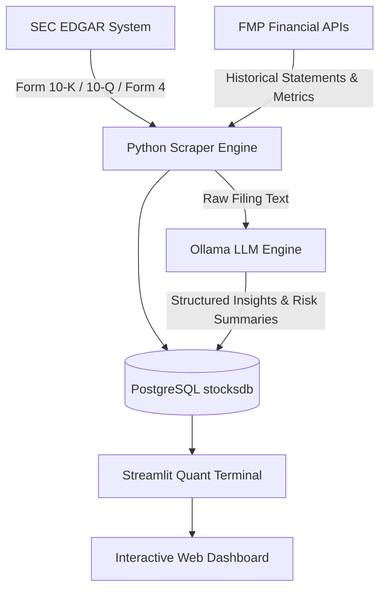

# 📊 TurtleVest Quant Terminal

> **A student-built quantitative research platform bridging academic corporate finance, automated SEC EDGAR data pipelines, and natural language processing (NLP).**

Developed by **Rithik Reddy** as an advanced quantitative extension to the [TurtleVest iOS](https://turtlevest.com) financial literacy initiative.

---

## 🎯 Project Overview

TurtleVest Quant analyzes corporate financial health, capital allocation efficiency, and qualitative risk disclosures. Rather than relying solely on delayed backward-looking metrics, the platform ingests official SEC filings directly from the SEC EDGAR system and synthesizes multi-year audited annuals (**Form 10-K**) with live interim quarterly disclosures (**Form 10-Q**).

---

## 💡 Core Financial Methodologies & Concepts

### 1. TTM (Trailing Twelve Months)

#### What is TTM?
**TTM** stands for **Trailing Twelve Months** (also referred to as **LTM** or *Last Twelve Months*). It represents a financial measurement that aggregates data from the **most recent 12 consecutive months (4 reported quarters)** up to today, rather than waiting for a completed calendar or fiscal year.

#### Why is TTM Critical in Quantitative Research?
1. **Eliminates Stale Annual Data**:
   * For companies with calendar year-ends (ending December 31), the annual Form 10-K report is only filed once a year (in February/March).
   * By October, an annual report from the prior year is already **9 to 10 months old**.
   * TTM solves this by rolling forward every quarter when a new **Form 10-Q** is filed, ensuring the metrics reflect current fundamental performance.

2. **Smooths Out Seasonal Distortions**:
   * Many corporations experience dramatic seasonality (e.g., Apple and Amazon generate a disproportionate amount of revenue during the Q4 holiday shopping season).
   * Comparing a single quarter to another single quarter can produce misleading conclusions.
   * By summing **four consecutive quarters**, TTM always covers a full annual business cycle while remaining up-to-date.

#### How TTM is Calculated in TurtleVest Quant:
When analyzing a company whose current fiscal year is still in progress (e.g., JPMorgan Chase or CoreWeave in late 2026):

$$\text{TTM Metric} = \sum_{i=1}^{4} \text{Quarterly Metric (Form 10-Q)}_i$$

**Real Examples from the Platform:**
* **JPMorgan Chase (`JPM`)**:
  * Q4 2025 + Q1 2026 + Q2 2026 + Q3 2026
  * TTM Net Revenue: **$301.92 Billion**
  * TTM Operating Expense: **$105.44 Billion**
  * **2026 (TTM) Efficiency Ratio**: $\frac{\$105.44\text{B}}{\$301.92\text{B}} = \mathbf{34.92\%}$

* **CoreWeave (`CRWV`)**:
  * Sum of last 4 reported quarters through Q2 2026:
  * TTM Revenue: **$7.59 Billion**
  * TTM CapEx: **$20.57 Billion**
  * **2026 (TTM) CapEx to Revenue Ratio**: $\frac{\$20.57\text{B}}{\$7.59\text{B}} = \mathbf{271.0\%}$

---

### 2. Capital Allocation & Operating Architecture (CapEx to Revenue)

$$\text{CapEx Efficiency} = \frac{\text{Capital Expenditures (CapEx)}}{\text{Total Revenue}} \times 100$$

The platform explores why different business models produce radically different capital expenditure profiles:

* **Fabless Semiconductor Model (e.g., NVIDIA `NVDA`: ~2%–4% CapEx)**:
  * NVIDIA designs high-performance graphics and AI compute silicon but outsources physical fabrication to Taiwan Semiconductor Manufacturing Company (TSMC).
  * TSMC incurs the tens of billions in fabrication cleanrooms and EUV lithography equipment, allowing NVIDIA to operate with software-like gross margins (75%+) and convert over 45% of revenue into Free Cash Flow.

* **Pure-Play AI GPU Hyperscaler (e.g., CoreWeave `CRWV`: ~200%–271% CapEx)**:
  * CoreWeave acquires tens of thousands of NVIDIA H100, H200, and Blackwell GPU clusters upfront to build out high-density data centers.
  * Multi-billion-dollar enterprise cloud contracts (with Microsoft, OpenAI, etc.) recognize revenue ratably over 3 to 5 years, while physical server acquisitions hit cash flow immediately.
  * The resulting 271% CapEx-to-Revenue ratio is funded via non-dilutive debt and OEM financing facilities rather than current operating cash flows.

* **Asset-Light Consumer Ecosystem (e.g., Apple `AAPL`: ~2.5%–3.5% CapEx)**:
  * Apple outsources hardware assembly to contract manufacturers (Foxconn, Pegatron), enabling minimal physical CapEx and directing $100B+ annual operating cash flow into share repurchases and services growth.

---

### 3. Bank Operating Efficiency Ratio

Traditional industrial metrics like CapEx and Free Cash Flow do not apply to commercial banks due to deposit and loan cash dynamics. Instead, the platform tracks the **Bank Efficiency Ratio (Overhead Ratio)**:

$$\text{Bank Efficiency Ratio} = \frac{\text{Non-Interest Operating Expenses}}{\text{Total Net Revenue}} \times 100$$

* **Lower is better**: Indicates how many cents of overhead expense a bank incurs to generate $1.00 of revenue.
* **Tier 1 Classification**: A ratio below **40%** represents world-class operating efficiency (e.g., JPMorgan Chase maintaining ~31%–35% through the interest rate cycle).

---

### 4. Natural Language Processing (NLP) & Qualitative Risk Parsing

Beyond numerical ratios, TurtleVest Quant analyzes the qualitative text of corporate filings using local LLM inference (Ollama / Llama 3.2):
* **Item 1A (Risk Factors)**: Identifies structural vulnerabilities, regulatory litigation, and supplier concentration.
* **Item 2 (Management’s Discussion & Analysis - MD&A)**: Synthesizes executive forward guidance and capital commitments.
* **Semantic Anxiety Index**: Measures executive tone and risk term density across consecutive filings to detect management uncertainty before it reflects in financial statements.

---

## 🏗️ Technical Architecture



* **Frontend**: Streamlit, Plotly Express, Vanilla CSS dark-mode styling.
* **Data Pipelines**: Python (`requests`, `BeautifulSoup4`, `pandas`, `psycopg2`).
* **Database**: PostgreSQL (`stocksdb`) storing price series, insider trades, and parsed filing insights.
* **Inference**: Ollama (`llama3.2:latest`) executing structured document analysis.
* **Infrastructure**: Docker Compose containerized web app, worker, and Cloudflare Zero Trust Tunnel.

---

## 🚀 Running Locally

```bash
# 1. Clone repository
git clone https://github.com/chrithik/turtlevest-quant.git
cd turtlevest-quant

# 2. Build and launch containers
bash buildDocker.sh

# 3. Access local terminal
open http://localhost:8555
```

---

## 📄 License & Attribution

Developed by **Rithik Reddy** for educational research and quantitative analysis. Data sourced from the U.S. Securities and Exchange Commission (SEC EDGAR) and Financial Modeling Prep. Not investment advice.
